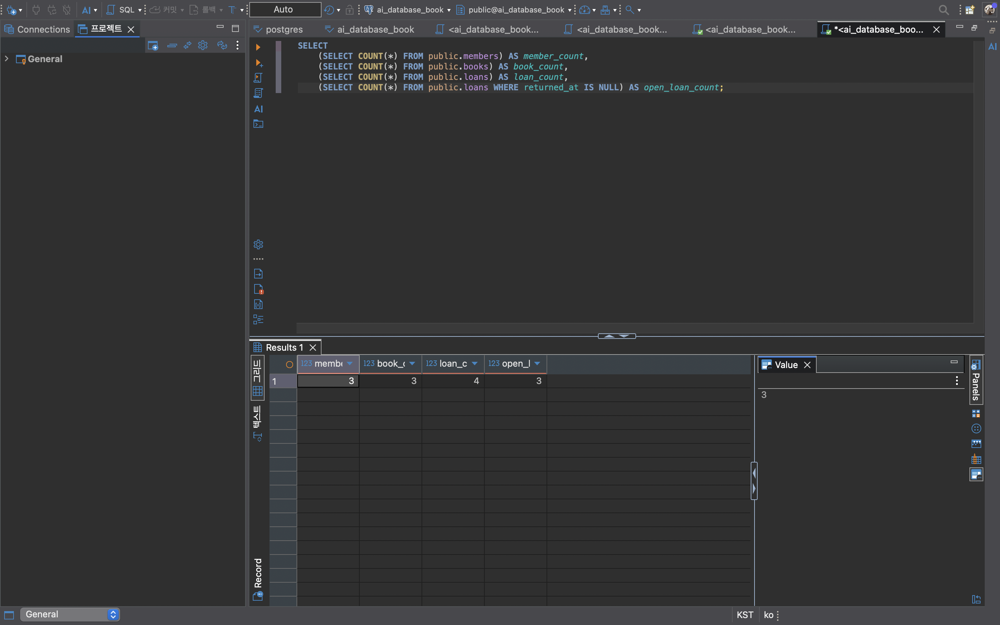
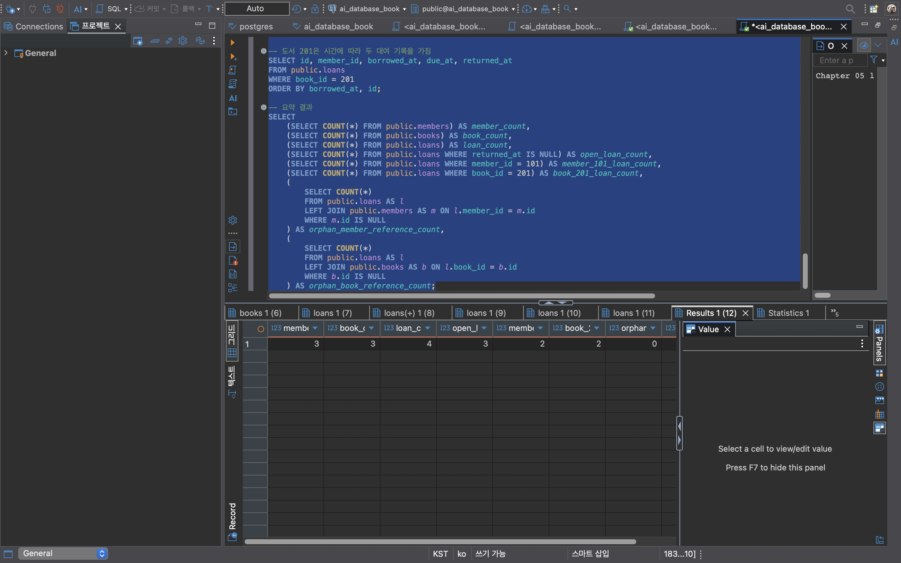
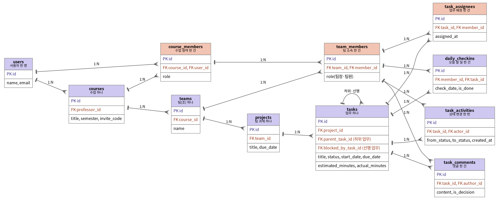

# Chapter 05 확장 실습 답안 템플릿

> **과제:** 요구사항에서 데이터 모델과 ERD 만들기  
> **사용 방법:** 이 파일을 내려받아 본인의 GitHub 저장소에 `chapter05_answer.md`라는 이름으로 저장한 뒤 실습하면서 바로 작성합니다.  
> **제출 방법:** LMS에는 파일을 직접 업로드하지 않고, **본인 GitHub 저장소의 `chapter05_answer.md` 파일 URL**을 제출합니다.

---

## 제출 전 주의

이 파일과 캡처 화면에는 실제 비밀번호, 전체 DB 접속 URL, API Key, 개인정보를 기록하지 않습니다.

```text
GitHub 계정 또는 별칭: han-jaesun
과제 작성일: 2026-10-11
사용한 AI 도구: Claude
```

---

# 1. Chapter 05 핵심 개념 복습

본문을 보지 않고 먼저 작성합니다.

```text
요구사항에서 바로 테이블부터 만들면 위험한 이유:
요구사항 문장에 보이는 명사를 그대로 테이블로 만들면, 무엇이 독립된 대상이고 무엇이 속성이나 사건인지 구분하지 못한 채
구조가 굳어진다. 나중에 "대여는 반복된다", "ISBN이 없을 수도 있다" 같은 사실이 드러나면 테이블을 다시 뜯어고쳐야 한다.

한 행의 의미를 먼저 정해야 하는 이유:
한 행이 무엇을 뜻하는지 정해야 어떤 값이 그 행에 들어가야 하는지, 무엇으로 행을 구분할지(PK), 몇 건이 쌓일지가 정해진다.
예를 들어 books 한 행이 "책 제목 하나"인지 "실물 책 한 권"인지에 따라 복본 처리 방식이 완전히 달라진다.

확정 요구사항과 미확정 정책을 구분해야 하는 이유:
확정된 것만 제약조건으로 만들고, 아직 정해지지 않은 정책은 질문으로 남겨야 한다.
미확정 정책을 추측으로 UNIQUE나 NOT NULL로 만들면 실제 업무와 다를 때 정상 데이터까지 막게 된다.

PK와 업무상 고유값 후보의 차이:
PK는 DB가 행을 안정적으로 구분하기 위한 내부 식별자(예: id)이고, 업무상 고유값은 실제 업무에서 쓰는 값(예: 이메일, ISBN)이다.
업무상 값은 바뀌거나 비어 있거나 중복될 수 있어서, 고유하다고 확인되기 전에는 PK로 쓰지 않는다.

N:M 관계를 그대로 두지 않고 연결 테이블을 검토하는 이유:
관계형 테이블은 칸 하나에 여러 값을 담을 수 없어서 N:M을 직접 표현할 수 없다.
또 "언제 빌렸는지, 언제 반납했는지"처럼 관계 자체에 붙는 정보가 생기는데, 이를 저장할 곳이 연결 테이블이다.
```

---

# 2. 도서 대여 요구사항 R-01~R-07 다시 분해

| 요구사항 | 관리 대상 / 사건 | 속성 후보 | 관계 / 규칙 후보 | 미확정 질문 |
| --- | --- | --- | --- | --- |
| R-01 도서관은 회원을 관리한다 | 회원 (대상) | – | 회원은 독립적으로 식별되어야 함 | 탈퇴 회원 기록은 삭제하는가, 보관하는가? |
| R-02 회원은 이름, 이메일, 가입일을 가진다 | 회원 | 이름, 이메일, 가입일 | 세 값 모두 회원이 가지는 값 (필수 여부 확인) | 이메일은 회원마다 반드시 고유한가? |
| R-03 도서는 제목·저자, 출판연도·ISBN도 저장 가능 | 도서 (대상) | 제목, 저자, 출판연도, ISBN | 제목·저자는 필수, 출판연도·ISBN은 선택("저장할 수 있다") | ISBN이 없는 도서가 있는가? 같은 ISBN의 복본은 따로 관리하는가? 저자가 여러 명이면? |
| R-04 회원은 여러 권의 책을 대여할 수 있다 | 대여 (사건) | – | 회원 1 : 대여 N | 동시에 빌릴 수 있는 권수 제한이 있는가? |
| R-05 책은 시간에 따라 여러 번 대여될 수 있다 | 대여 (사건) | – | 도서 1 : 대여 N, 같은 책도 반복 대여 | 같은 책을 두 사람이 동시에 빌릴 수 있는가? |
| R-06 대여 기록에 대여일, 반납예정일, 실제반납일 저장 | 대여 기록 | 대여일, 반납예정일, 실제반납일 | 날짜 세 개는 대여 사건의 속성 | 반납예정일은 대여일 기준 며칠인가? 연장이 가능한가? |
| R-07 미반납이면 실제반납일이 비어 있을 수 있다 | 대여 기록 | 실제반납일 | 실제반납일은 NULL 허용 (NULL = 미반납) | 분실·연체 같은 다른 상태도 표현해야 하는가? |

### 본문과 비교한 뒤 수정한 내용

```text
처음에 놓친 부분:
R-03의 "저장할 수 있다"는 표현이 출판연도와 ISBN이 선택값이라는 뜻이라는 점을 처음엔 놓쳤다.

처음에 잘못 분류한 부분:
처음에는 "대여"를 회원과 도서를 잇는 단순 연결로 보았는데, 대여일·반납일을 가지고 같은 책도 여러 번 반복되므로
독립된 사건(엔터티)으로 다시 분류했다.

수정한 이유:
R-05(같은 책의 반복 대여)와 R-06(날짜 저장)을 함께 보면, 한 행이 "회원–도서 짝"이 아니라 "대여 사건 한 건"이어야
같은 회원이 같은 책을 다시 빌리는 경우도 저장할 수 있기 때문이다.
```

---

# 3. 확정 규칙과 미확정 정책 구분

## 3-1. 확정된 규칙

```text
1. 회원은 이름, 이메일, 가입일을 가진다. (R-02)
2. 도서는 제목과 저자를 반드시 가지며, 출판연도와 ISBN은 저장할 수도 있고 비어 있을 수도 있다. (R-03)
3. 한 회원은 여러 번 대여할 수 있다. (R-04)
4. 한 도서는 시간에 따라 여러 번 대여될 수 있다. (R-05)
5. 대여 기록은 대여일, 반납예정일, 실제반납일을 가지며, 미반납이면 실제반납일이 비어 있다. (R-06, R-07)
```

## 3-2. 미확정 질문

최소 5개를 작성합니다.

```text
Q1. 회원 이메일은 반드시 고유해야 하는가? (가족이 이메일 하나를 같이 쓰는 경우는?)
Q2. ISBN이 없는 도서가 있는가? ISBN은 고유한가?
Q3. 같은 ISBN의 실물 책이 여러 권(복본)일 때 따로 관리하는가?
Q4. 한 도서에 저자가 여러 명이면 어떻게 저장하는가?
Q5. 같은 책을 두 회원이 동시에 대여할 수 있는가? (실물 한 권이면 불가능하지만 복본이면 가능)
Q6. 한 회원이 동시에 빌릴 수 있는 권수 제한이 있는가?
Q7. 탈퇴한 회원의 대여 기록은 삭제하는가, 보관하는가?
```

### 미확정 정책을 바로 `UNIQUE`, `CHECK`, 삭제 규칙으로 구현하면 위험한 이유

```text
예를 들어 ISBN에 UNIQUE를 걸었는데 실제로는 같은 ISBN의 복본이 있다면, 두 번째 책을 등록하는 순간 오류가 나서
정상적인 업무가 막힌다. 반대로 나중에 제약조건을 추가하려 하면 이미 쌓인 데이터가 규칙을 어기고 있어 추가 자체가 실패할 수 있다.
그래서 정책이 확정되기 전에는 질문으로 남기고, 확정된 규칙만 제약조건으로 옮긴다.
```

---

# 4. 엔터티·속성·사건 후보 구분

| 후보 | 대상 엔터티 / 사건 엔터티 / 속성 | 판단 근거 | 독립 식별 필요? |
| --- | --- | --- | --- |
| 회원 | 대상 엔터티 | 이름·이메일·가입일 여러 속성을 가지고 여러 명이 저장되며 대여와 관계를 맺음 | 필요 |
| 도서 | 대상 엔터티 | 제목·저자 등 여러 속성을 가지고 대여와 관계를 맺음 | 필요 |
| 대여 기록 | 사건 엔터티 | 시간에 따라 반복되는 사건이고, 날짜 속성을 가지며 회원·도서와 연결됨 | 필요 |
| 이메일 | 속성 (회원) | 회원을 설명하는 값 하나로, 스스로 다른 속성을 가지지 않음 | 불필요 |
| ISBN | 속성 (도서) | 도서를 설명하는 값. 고유성이 확인되면 업무 식별자 후보 | 불필요 (지금은) |
| 반납예정일 | 속성 (대여) | 대여 사건 한 건마다 하나씩 정해지는 날짜 | 불필요 |

### "명사가 보이면 무조건 테이블"이 아닌 이유

```text
이메일, ISBN, 반납예정일도 명사지만, 스스로 여러 속성을 가지거나 독립적으로 식별될 필요가 없어서 다른 테이블의 열(속성)이다.
명사마다 테이블을 만들면 테이블이 쓸데없이 쪼개져 JOIN만 늘고, 반대로 "대여"처럼 동사에서 나온 사건이 오히려 테이블이 되기도 한다.
그래서 독립 식별, 여러 속성, 반복 저장, 다른 대상과의 관계 여부로 판단한다.
```

---

# 5. 테이블별 한 행의 의미와 키 후보

| 테이블 | 한 행의 의미 | PK 후보 | 업무상 고유값 후보 | FK 후보 |
| --- | --- | --- | --- | --- |
| `members` | 회원 한 명 | id | email (고유성 미확정) | – |
| `books` | 이 장에서 대여 대상으로 취급하는 도서 항목 한 건 | id | isbn (존재·고유성 미확정) | – |
| `loans` | 특정 회원이 특정 도서를 대여한 사건 한 건 | id | – | member_id → members.id, book_id → books.id |

### `members.email`을 지금 바로 UNIQUE라고 확정하지 않는 이유

```text
요구사항(R-02)은 회원이 이메일을 "가진다"고만 했지 고유하다고는 하지 않았다.
가족이 이메일 하나를 같이 쓰거나 재가입하는 경우가 있을 수 있어, 고유성은 미확정 질문(Q1)으로 남긴다.
그래서 NOT NULL은 적용하되 UNIQUE는 적용하지 않았다.
```

### `books.isbn`을 지금 바로 NOT NULL + UNIQUE라고 확정하지 않는 이유

```text
R-03은 ISBN을 "저장할 수 있다"고 해서 없는 도서도 있을 수 있다(오래된 책, 자료집 등). 그래서 NOT NULL을 걸 수 없다.
또 같은 ISBN의 실물 복본을 따로 관리할지(Q3)가 정해지지 않아서, UNIQUE를 걸면 복본 등록이 막힐 수 있다.
```

---

# 6. 관계를 양방향 문장으로 작성

## 6-1. `members ↔ loans`

```text
회원 한 명은 대여 기록을 0건 이상 여러 건 가질 수 있다.

대여 기록 한 건은 반드시 회원 한 명에게 속한다.

카디널리티: members 1 : N loans
선택성에서 확인할 점: 회원은 대여 기록이 없어도 존재할 수 있다(가입만 한 회원). 반대로 대여 기록은 회원 없이 존재할 수 없으므로
loans.member_id는 NOT NULL이다.
```

## 6-2. `books ↔ loans`

```text
도서 한 건은 시간에 따라 대여 기록을 0건 이상 여러 건 가질 수 있다.

대여 기록 한 건은 반드시 도서 한 건을 대상으로 한다.

카디널리티: books 1 : N loans
선택성에서 확인할 점: 한 번도 대여되지 않은 도서도 존재할 수 있다. 같은 도서의 대여 기록이 여러 건일 때
기간이 겹쳐도 되는지(동시 대여)는 미확정(Q5)이다.
```

## 6-3. `members ↔ books`를 직접 N:M으로 저장하지 않고 `loans`를 두는 이유

```text
회원과 도서는 서로 여러 개와 연결되는 N:M 관계지만, 테이블의 칸 하나에는 여러 값을 담을 수 없어서 직접 저장할 수 없다.
또 같은 회원이 같은 책을 시간 차를 두고 다시 빌리는 경우, "회원–도서 짝" 한 줄로는 두 번의 대여를 구분할 수 없다.
그래서 대여 한 건을 한 행으로 하는 loans를 두고, 회원 1:N 대여, 도서 1:N 대여 두 관계로 나눴다.
```

### `loans`가 단순 연결표가 아니라 사건 엔터티라고 볼 수 있는 이유

```text
loans는 회원과 도서를 잇기만 하는 것이 아니라, 대여일·반납예정일·실제반납일이라는 사건 자체의 속성을 가진다.
그리고 같은 회원–도서 조합이 여러 번 반복될 수 있어 자기만의 식별자(id)가 필요하다.
즉 "누가 무엇을 빌렸다"는 일이 시간 위에서 일어난 사건 한 건이므로 사건 엔터티다.
```

---

# 7. 도서 대여 ERD 초안

아래 항목이 보이도록 ERD를 작성합니다.

```text
members
books
loans
PK
FK
주요 속성
1:N 관계
```

권장 이미지 경로:

```text
assignments/chapter05/images/step07_library_erd.png
```

Markdown 예시:

```markdown

```

`여기에 ERD 이미지를 삽입하세요.`

### ERD를 그린 뒤 수정한 부분

```text
처음에는 members와 books 사이에 직접 선을 그었으나, 같은 책의 반복 대여와 대여 날짜를 표현할 수 없어서
가운데에 loans를 두고 1:N 관계 두 개로 바꿨다.
또 email과 isbn 옆에 "UNIQUE 미확정"을 표시해, 확정되지 않은 정책이 그림에서도 드러나게 했다.
```

---

# 8. PostgreSQL로 도서 대여 모델 구현 확인

## 8-1. 현재 환경 확인

```sql
SELECT current_database();
SELECT current_user;
SELECT current_schema();
SHOW search_path;
SHOW transaction_read_only;
```

```text
현재 DB: ai_database_book
현재 사용자: hanjaesun
현재 스키마: public
search_path: public, "$user"
읽기 전용 여부: off
```

- [O] 현재 DB가 `ai_database_book`이다.
- [O] 실행 범위를 확인했다.
- [O] Auto-commit 상태를 확인했다.

## 8-2. 스키마 생성 SQL 실행

사용 파일:

```text
code/chapter05/01_library_schema.sql
```

실행 전 예상:

```text
생성될 테이블 수: 3개 (members, books, loans)
생성 순서: members → books → loans
각 테이블 예상 행 수: 모두 0행
```

실행 후 실제:

```text
members 존재: 예 (members)
books 존재: 예 (books)
loans 존재: 예 (loans)
각 테이블 행 수: 모두 0행
```

### `loans`를 마지막에 만드는 이유

```text
loans는 member_id와 book_id로 members와 books를 참조하는 FK를 가진다.
FK는 참조할 대상 테이블이 이미 있어야 만들 수 있으므로, 부모 테이블인 members와 books를 먼저 만들고 loans를 마지막에 만든다.
```

---

# 9. 샘플 데이터 입력과 관계 관찰

사용 파일:

```text
code/chapter05/02_library_seed.sql
```

## 9-1. 실행 전 예상

```text
members 예상 행 수: 3
books 예상 행 수: 3
loans 예상 행 수: 4
미반납 예상 건수: 3
회원 101 대여 예상 건수: 2
도서 201 대여 예상 건수: 2
```

## 9-2. 실제 결과

```text
members 실제 행 수: 3
books 실제 행 수: 3
loans 실제 행 수: 4
미반납 실제 건수: 3
회원 101 대여 실제 건수: 2
도서 201 대여 실제 건수: 2
```

### 샘플 데이터에서 확인한 1:N 관계

```text
회원 101(김민지)은 대여 1001(도서 201)과 1002(도서 202) 두 건을 가져 members 1 : N loans가 확인된다.
도서 201(데이터베이스 입문)은 4월 1일 김민지에게, 반납 후 4월 3일 이준호에게 대여되어 books 1 : N loans가 확인된다.
같은 책이 시간 차를 두고 다른 회원에게 다시 대여된 것이 R-05(반복 대여)를 보여 준다.
```

### `returned_at = NULL`이 의미하는 것

```text
아직 반납하지 않은 대여라는 뜻이다(R-07). 반납일을 "모르는" 것이 아니라 "아직 반납 사건이 일어나지 않은" 상태다.
1002, 1003, 1004 세 건이 NULL이라 미반납이 3건이다. 미반납 대여는 WHERE returned_at IS NULL로 찾는다.
```

### 증거 화면

```text
assignments/chapter05/images/step09_seed_result.png
```



---

# 10. 검증 SQL 실행

사용 파일:

```text
code/chapter05/03_library_validation.sql
```

## 10-1. 결과 기록

```text
members = 3
books = 3
loans = 4
미반납 건수 = 3
회원 101 대여 이력 = 2
도서 201 대여 이력 = 2
회원 참조 고아 행 = 0
도서 참조 고아 행 = 0
loans FK 개수 = 2
검증 최종 메시지 = Chapter 05 library model validation passed
```

### 단순히 테이블 3개가 생성되었다고 설계 검증이 끝난 것이 아닌 이유

```text
테이블이 만들어졌다는 것은 문법이 맞았다는 뜻일 뿐, 요구사항을 제대로 담았는지는 알 수 없다.
실제 데이터를 넣어 반복 대여가 저장되는지(R-04, R-05), 미반납이 NULL로 표현되는지(R-07),
없는 회원·도서를 가리키는 고아 행이 없는지, FK가 실제로 2개 걸려 있는지를 확인해야 설계가 요구사항을 만족한다고 말할 수 있다.
```

### 증거 화면

```text
assignments/chapter05/images/step10_validation.png
```



---

# 11. 작은 시나리오로 모델 검증

| 시나리오 | 표현 가능? | 이유 | 추가 확인할 정책 |
| --- | --- | --- | --- |
| 회원 A가 서로 다른 책 2권을 대여 | 가능 | loans에 같은 member_id로 두 행 저장 (회원 101 사례) | 동시 대여 권수 제한 |
| 같은 책을 시간 차를 두고 다시 대여 | 가능 | loans가 사건 단위라 같은 book_id로 여러 행 저장 (도서 201 사례) | – |
| 아직 반납하지 않은 대여 | 가능 | returned_at을 NULL로 저장 | 연체·분실 상태 구분 필요 여부 |
| 회원은 있지만 대여 기록이 없음 | 가능 | members 행만 있고 loans에 없으면 됨 (FK는 loans 쪽에만 있음) | – |
| ISBN이 없는 도서 | 가능 | isbn이 NULL 허용 | ISBN 없는 도서를 어떻게 식별할지 |
| 같은 ISBN의 실물 복본 2권 | 부분 가능 | isbn에 UNIQUE가 없어 두 행 저장은 되지만, 두 행이 같은 책의 복본인지 다른 책인지 구분할 구조가 없음 | 도서(작품)와 실물 책(복본)을 분리할지 |
| 한 도서에 저자 2명 | 부분 가능 | author 칸 하나에 "홍길동, 이몽룡"처럼 문자열로만 저장 가능. 저자별 검색·관리는 어려움 | 저자를 별도 테이블로 분리할지 |
| 같은 도서를 두 명이 동시에 대여 | 저장은 되지만 막을 수 없음 | 기간이 겹치는 두 대여 행을 DB가 차단하지 않음 | 동시 대여 금지 여부(Chapter 06에서 제약조건 검토) |

### 현재 Chapter 05 모델의 한계 3가지

```text
1. 작품(도서 정보)과 실물 책(복본)을 구분하지 않아, 같은 ISBN의 책이 여러 권일 때 관리가 모호하다.
2. 저자를 문자열 하나로 저장해, 공동 저자나 저자별 조회를 제대로 표현하지 못한다.
3. 같은 책의 대여 기간이 겹치는 것(동시 대여)이나 반납일이 대여일보다 빠른 잘못된 데이터를 DB가 막지 못한다.
```

---

# 12. Chapter 01~04 개인 서비스 요구사항 작성

지금까지 선택한 개인 서비스 아이디어를 사용합니다.

```text
서비스 이름: 태스크허브 (TaskHub)
서비스 목적: 대학생 팀플에서 할 일을 나눠 맡고, 업무마다 논의를 남기며, 서로 미루지 않게 돕는 팀 협업 서비스
```

> 학기 프로젝트 주제(태스크허브)를 그대로 사용한다. Chapter 01~02의 스터디메이트에서 "참여 신청·출석" 대신 "업무 분담·진행"으로 발전시킨 주제다.

## 12-1. 요구사항

```text
P05-R01. 사용자는 이름과 이메일을 가진다.
P05-R02. 교수는 수업을 개설하고, 학생과 조교는 여러 수업에 참여할 수 있다. 참여할 때 수업 안에서의 역할(교수·조교·학생)을 가진다.
P05-R03. 교수는 수업 안에서 팀을 만들고, 그 수업에 참여한 학생을 팀원으로 지정한다. 팀원은 팀장 또는 팀원 역할을 가진다.
P05-R04. 팀은 여러 과제를 가지며, 과제는 제목과 마감일을 가진다.
P05-R05. 과제는 여러 업무로 나뉘며, 업무는 제목·상태·시작일·마감일·예상 시간을 가진다. 큰 업무는 하위 업무로 쪼갤 수 있다.
P05-R06. 한 업무에 여러 팀원을 배정할 수 있고, 한 팀원은 여러 업무를 맡을 수 있다.
P05-R07. 팀원은 업무에 댓글을 남기며, 팀이 합의한 댓글은 결정 사항으로 표시할 수 있다.
P05-R08. 업무의 상태가 바뀔 때마다 누가, 언제, 어떤 상태에서 어떤 상태로 바꿨는지 기록한다.
P05-R09. 팀원은 날짜마다 오늘 할 업무를 정하고 완료 여부를 기록한다.
P05-R10. 업무는 먼저 끝나야 하는 선행 업무를 가질 수 있으며, 선행 업무가 끝나기 전에는 대기 상태로 본다.
```

## 12-2. 미확정 질문

```text
P05-Q01. 한 학생이 같은 수업에서 두 팀 이상에 속할 수 있는가?
P05-Q02. 정체 업무로 볼 기준은 며칠인가? 기준을 팀이 정할 수 있게 하는가?
P05-Q03. 결정 사항 표시는 팀장만 할 수 있는가, 팀원 누구나 할 수 있는가?
P05-Q04. 학생이 수업을 드롭하면 담당 업무·댓글·이력은 삭제하는가, 보관하는가?
P05-Q05. 한 팀원이 같은 날 오늘 할 업무를 여러 개 고를 수 있는가?
```

---

# 13. 개인 서비스 모델 초안

## 13-1. 엔터티·사건 후보표

| 후보 | 대상 / 사건 | 한 행의 의미 | 주요 속성 | PK 후보 | 업무 식별자 후보 |
| --- | --- | --- | --- | --- | --- |
| 사용자 (`users`) | 대상 | 사용자 한 명 | name, email | id | email (고유성 확인 필요) |
| 수업 (`courses`) | 대상 | 개설된 수업 하나 | title, semester, invite_code | id | invite_code |
| 수업 참여 (`course_members`) | 사건(연결) | 한 사용자가 특정 수업에 참여한 기록 한 건 | role, joined_at | id | – |
| 팀 (`teams`) | 대상 | 수업 안의 팀 하나 | name | id | – |
| 팀 소속 (`team_members`) | 사건(연결) | 한 수업 참여자가 특정 팀에 속한 기록 한 건 | role | id | – |
| 과제 (`projects`) | 대상 | 한 팀의 과제 하나 | title, due_date | id | – |
| 업무 (`tasks`) | 대상 | 업무 하나 | title, status, start_date, due_date, estimated_minutes | id | – |
| 업무 배정 (`task_assignees`) | 사건(연결) | 한 업무에 한 팀원이 배정된 기록 한 건 | assigned_at | id | – |
| 댓글 (`task_comments`) | 사건 | 업무에 남긴 댓글 한 건 | content, is_decision, created_at | id | – |
| 상태 이력 (`task_activities`) | 사건 | 업무 상태가 바뀐 한 번 | from_status, to_status, created_at | id | – |
| 오늘 할 일 (`daily_checkins`) | 사건 | 한 팀원이 특정 날짜에 오늘 할 업무로 정한 기록 한 건 | check_date, is_done | id | – |

## 13-2. 관계 문장

```text
관계 1: projects ↔ tasks
과제 한 건은 업무를 0개 이상 여러 개 가질 수 있다.
업무 한 건은 반드시 과제 하나에 속한다.
→ projects 1 : N tasks

관계 2: tasks ↔ task_assignees ↔ team_members
업무 한 건은 배정 기록을 여러 건 가질 수 있다(담당자 여러 명).
팀원 한 명은 배정 기록을 여러 건 가질 수 있다(업무 여러 개).
배정 기록 한 건은 업무 하나와 팀원 한 명을 연결한다.
→ tasks 1 : N task_assignees N : 1 team_members (업무와 팀원은 N:M)

관계 3: tasks ↔ task_activities
업무 한 건은 상태 변경 기록을 0건 이상 여러 건 가진다.
상태 변경 기록 한 건은 반드시 업무 하나에 대한 것이다.
→ tasks 1 : N task_activities

관계 4: tasks ↔ tasks (자기 참조)
업무 한 건은 하위 업무를 0개 이상 가질 수 있다.
하위 업무 한 건은 상위 업무를 최대 하나 가진다.
→ tasks 1 : N tasks (parent_task_id)
```

## 13-3. N:M 관계 검토

```text
N:M 관계 후보: 업무 ↔ 팀원 (한 업무에 여러 담당자, 한 팀원에게 여러 업무)
연결 테이블 후보: task_assignees
연결 테이블 한 행의 의미: 특정 업무에 특정 팀원이 배정된 기록 한 건
연결 테이블 자체에 필요한 사건 속성: assigned_at(언제 배정되었는지). 이후 배정 해제를 이력으로 남길지에 따라 unassigned_at도 검토

추가 N:M: 사용자 ↔ 수업은 course_members, 수업 참여자 ↔ 팀은 team_members로 해결하며,
두 연결 테이블 모두 role(역할)이라는 관계 자체의 속성을 가진다.
```

---

# 14. 개인 서비스 ERD 초안

ERD에 최소 다음을 표시합니다.

```text
테이블 3개 이상
각 테이블 PK
주요 속성
필요한 FK
관계선
카디널리티
```

권장 이미지 경로:

```text
assignments/chapter05/images/step14_my_erd.png
```



### ERD의 각 테이블이 어떤 요구사항에서 나왔는지 설명

| 테이블 | 근거 요구사항 ID | 한 행의 의미 |
| --- | --- | --- |
| `users` | P05-R01 | 사용자 한 명 |
| `courses`, `course_members` | P05-R02 | 수업 하나 / 한 사용자의 수업 참여 한 건 |
| `teams`, `team_members` | P05-R03 | 팀 하나 / 한 참여자의 팀 소속 한 건 |
| `projects` | P05-R04 | 팀 과제 하나 |
| `tasks` | P05-R05, P05-R10 | 업무 하나 (하위 업무·선행 업무는 자기 참조) |
| `task_assignees` | P05-R06 | 업무 배정 한 건 |
| `task_comments` | P05-R07 | 업무 댓글 한 건 |
| `task_activities` | P05-R08 | 업무 상태 변경 한 번 |
| `daily_checkins` | P05-R09 | 오늘 할 일 기록 한 건 |

---

# 15. 요구사항 추적표

| 요구사항 ID | 데이터 모델 반영 위치 | 검증 방법 | 상태 |
| --- | --- | --- | --- |
| P05-R01 | `users.name`, `users.email` | 사용자 행 입력 후 조회 | 반영 |
| P05-R02 | `courses`, `course_members.role` | 한 학생을 두 수업에 참여시키고 역할 확인 | 반영 |
| P05-R03 | `teams`, `team_members.member_id → course_members.id` | 수업에 참여하지 않은 사용자를 팀원으로 넣을 때 FK로 막히는지 확인 | 반영 |
| P05-R04 | `projects.team_id`, `projects.due_date` | 한 팀에 과제 2개 입력 | 반영 |
| P05-R05 | `tasks`, `tasks.parent_task_id` | 상위 업무 아래 하위 업무 2개 입력 후 자기 참조 조회 | 반영 |
| P05-R06 | `task_assignees` | 한 업무에 팀원 2명, 한 팀원에 업무 2개 배정 | 반영 |
| P05-R07 | `task_comments.is_decision` | 결정 사항만 WHERE로 조회 | 반영 |
| P05-R08 | `task_activities` | 상태 변경 후 이력 행이 생겼는지 조회 | 반영 |
| P05-R09 | `daily_checkins` | 같은 팀원의 날짜별 기록 조회 | 반영 (하루 여러 개 허용 여부는 확인필요) |
| P05-R10 | `tasks.blocked_by_task_id` | 선행 업무가 미완료일 때 대기로 보이는지 조회 | 확인필요 (선행 업무가 2개 이상인 경우) |

### ERD 그림만으로 요구사항 누락을 발견하기 어려운 이유

```text
ERD는 테이블과 선만 보여 주기 때문에, 그림이 그럴듯하면 요구사항을 다 담은 것처럼 보인다.
하지만 "결정 사항 표시"나 "선행 업무가 여러 개인 경우"처럼 열 하나, 관계 수 하나에 달린 요구사항은 그림에서 잘 드러나지 않는다.
요구사항 ID를 테이블·열에 하나씩 연결해 보는 추적표가 있어야 빠진 것을 찾을 수 있다.
```

---

# 16. 개인 서비스 작은 데이터 시나리오 검증

```text
사용자/대상 A: 학생 민지 (팀 1 팀장)
사용자/대상 B: 학생 준호 (팀 1 팀원)
대상 X: 업무 "자료 조사" (과제 "기말 발표", 마감 11/20)
대상 Y: 업무 "PPT 제작" (선행 업무: 자료 조사)
사건 1: 민지가 자료 조사를 민지와 준호 두 명에게 배정
사건 2: 11/15 준호가 "오늘 할 일"로 자료 조사를 정함
사건 3: 11/17 민지가 자료 조사 상태를 "진행 중 → 완료"로 바꿈
사건 4: 준호가 PPT 제작 댓글에 "16:9 비율로 하자"를 남기고, 민지가 결정 사항으로 표시
```

### 이 시나리오를 현재 ERD로 저장할 수 있는가?

```text
저장할 수 있다.
사건 1은 task_assignees 두 행, 사건 2는 daily_checkins 한 행, 사건 3은 tasks.status 변경과 task_activities 한 행,
사건 4는 task_comments 한 행(is_decision = true)으로 저장된다. PPT 제작의 선행 업무는 tasks.blocked_by_task_id로 저장된다.
```

### 저장하기 어려운 상황 또는 모호한 부분

```text
1. "PPT 제작"이 자료 조사뿐 아니라 "목차 확정"도 끝나야 시작할 수 있다면, blocked_by_task_id 칸 하나로는 선행 업무 2개를 저장할 수 없다.
2. 결정 사항 표시를 누가, 언제 했는지 남지 않는다. is_decision은 현재 상태만 담는다.
3. 사건 3에서 상태를 바꾼 사람은 남지만, 담당자가 아닌 사람이 바꿔도 되는지는 규칙이 없다.
```

### 시나리오 검증 후 수정한 ERD 내용

```text
선행 업무가 여러 개일 수 있으므로, 업무와 선행 업무의 관계는 사실상 N:M이다.
그래서 blocked_by_task_id 단일 칸 대신 task_dependencies(task_id, depends_on_task_id) 연결 테이블을 후보로 추가하기로 했다.
다만 실제로 선행 업무가 여러 개인 경우가 얼마나 흔한지 확인한 뒤 확정하기 위해 이번 ERD에는 단일 칸으로 두고 미확정으로 표시한다.
결정 사항 표시자는 decided_by, decided_at 열을 Chapter 06에서 검토한다.
```

---

# 17. AI를 설계자가 아니라 리뷰어로 활용

## 17-1. AI에게 전달한 핵심 자료

```text
요구사항: P05-R01 ~ P05-R10 (12-1과 동일)

미확정 질문: P05-Q01 ~ P05-Q05 (12-2와 동일)

테이블별 한 행 의미: 13-1 엔터티·사건 후보표와 동일

관계 문장: 13-2의 관계 1~4

ERD 설명: users–courses–teams–projects–tasks로 이어지는 1:N 구조, 연결 테이블 course_members·team_members·task_assignees,
tasks의 자기 참조 두 개(parent_task_id, blocked_by_task_id), 사건 테이블 task_comments·task_activities·daily_checkins
```

## 17-2. AI 검토 요청

```text
나는 데이터베이스를 배우는 대학생이고, 아래는 내가 설계한 팀플 협업 서비스의 요구사항과 데이터 모델 초안입니다.
(요구사항, 미확정 질문, 테이블별 한 행 의미, 관계 문장, ERD 설명 첨부)

정답 설계를 새로 만들어 주지 말고, 다음을 질문이나 지적 형태로 검토해 주세요.
1. 요구사항 중 데이터 모델에 반영되지 않은 것
2. 한 행의 의미가 모호한 테이블
3. N:M인데 1:N으로 잘못 표현한 관계
4. 미확정 정책을 내가 이미 확정한 것처럼 설계한 부분
5. 작은 데이터로 검증해 볼 만한 시나리오
요구사항에 없는 정책을 임의로 확정하지 마세요.
```

## 17-3. AI 제안 검토

| AI 제안 또는 질문 | 수용 / 수정 / 보류 / 거절 | 실제 근거 요구사항 | 나의 판단 이유 |
| --- | --- | --- | --- |
| 선행 업무가 여러 개일 수 있으면 `blocked_by_task_id` 한 칸으로는 부족하다. 업무–선행 업무는 N:M이 아닌가? | 수정 | P05-R10 | 시나리오 검증(16번)에서도 같은 문제를 발견했다. 연결 테이블 `task_dependencies`를 후보로 두되, 실제 빈도를 확인한 뒤 확정한다. |
| `team_members.member_id`가 `users`가 아니라 `course_members`를 가리키는 이유가 요구사항에 드러나는가? | 수용 | P05-R03 | R03의 "그 수업에 참여한 학생을 팀원으로"를 근거로 명시했다. 추적표의 검증 방법에도 FK로 막히는지 확인하는 항목을 넣었다. |
| 같은 학생이 같은 업무에 두 번 배정되지 않도록 `(task_id, member_id)`를 UNIQUE로 하라 | 보류 | P05-R06 | 배정 해제 후 재배정을 이력으로 남길지 정해지지 않았다. 이력을 남기면 같은 조합이 여러 행 필요하므로 Chapter 06에서 결정한다. |
| 학생은 한 수업에서 한 팀에만 속해야 하므로 `(course_id, user_id)` 기준 UNIQUE가 필요하다 | 거절 | P05-Q01 | 요구사항에 없는 정책이다. 한 수업에서 두 팀에 속할 수 있는지는 미확정 질문(Q01)으로 남겨 두었으므로 지금 확정하지 않는다. |
| `daily_checkins` 한 행이 "하루의 계획 전체"인지 "업무 하나"인지 모호하다 | 수용 | P05-R09 | 한 행 의미를 "특정 날짜에 오늘 할 업무로 정한 업무 한 건"으로 명확히 고쳤다. 하루 여러 개 허용 여부는 Q05로 남겼다. |
| 결정 사항을 누가 언제 표시했는지 남겨야 하지 않는가? | 보류 | P05-R07 | 요구사항은 "표시할 수 있다"까지만 말한다. 표시 이력이 필요한지는 Q03(표시 권한)과 함께 정한다. |

### AI가 요구사항에 없는 정책을 임의로 확정한 부분이 있었나요?

```text
있었다. "학생은 한 수업에서 한 팀에만 속해야 한다"며 UNIQUE를 제안했는데, 이는 요구사항에 없고
내가 미확정 질문(P05-Q01)으로 남겨 둔 정책이다. AI가 일반적인 경우를 근거로 정책을 확정하려 한 것이라 거절했다.
```

### AI 검토를 받고도 채택하지 않은 제안 하나와 그 이유

```text
(task_id, member_id) UNIQUE 제안은 채택하지 않고 보류했다.
지금은 중복 배정을 막는 것이 맞아 보이지만, 배정 해제와 재배정을 이력으로 남기기로 결정하면 같은 조합이 여러 행 필요해진다.
정책이 정해지기 전에 제약조건을 걸면 나중에 정상 데이터를 막을 수 있으므로 Chapter 06에서 결정한다.
```

---

# 18. 선택 — PostgreSQL DDL 초안

> 이 단계는 완성된 구현이 아니라 **현재 데이터 모델을 SQL 구조로 옮겨 보는 연습**입니다. Chapter 06에서 정규화와 제약조건을 더 엄격하게 검토합니다.

```sql
-- 개인 서비스 DDL 초안

```

### 아직 구현하지 않은 미확정 정책

```text
1.
2.
3.
```

---

# 19. 최종 성찰

```text
1. 요구사항에서 바로 테이블을 만들지 않고 중간 설계 과정을 거쳐야 하는 이유는
   회원 표에 "빌린 책" 칸을 바로 만들면 한 사람이 여러 권을 빌리거나 같은 책을 다시 빌리는 경우를 저장할 수 없는 것처럼,
   무엇이 대상이고 무엇이 반복되는 사건인지 먼저 정리하지 않으면 나중에 테이블을 처음부터 다시 만들어야 하기 때문이다.

2. 테이블의 한 행 의미가 중요한 이유는
   대여를 "회원–책 짝"으로 보느냐 "빌린 사건 한 건"으로 보느냐에 따라 같은 책을 다시 빌린 기록을 저장할 수 있는지가
   달라지는 것처럼, 한 행의 의미가 PK와 저장할 수 있는 데이터를 결정하기 때문이다.

3. 미확정 정책을 그대로 남겨 두는 것이 좋은 설계 활동일 수 있는 이유는
   가족이 이메일 하나를 같이 쓰거나 같은 책이 여러 권 있을 수 있는데, 확인하지 않고 UNIQUE를 걸면 정상적인 회원과 책이
   등록조차 안 되므로, 모르는 것은 추측으로 정하지 않고 질문으로 남겨 확인한 뒤 규칙으로 만드는 것이 안전하기 때문이다.

4. N:M 관계에서 연결 엔터티가 필요한 이유는
   칸 하나에 여러 값을 넣을 수 없고, 대여일·반납일이나 업무 배정일처럼 어느 한쪽이 아니라 "연결 자체"에 붙는 정보를
   저장할 곳이 필요하기 때문이다.

5. AI가 ERD를 만들어 주더라도 사람이 반드시 확인해야 하는 것은
   AI가 "한 수업에 한 팀만"처럼 요구사항에 없는 규칙을 그럴듯하게 정해 버리지 않았는지, 그리고 각 테이블과 규칙이
   실제 요구사항 어디에서 나왔는지이다.
```

---

# 20. 제출 체크리스트

- [O] `chapter05_answer.md`를 본인 저장소에 만들었다.
- [O] R-01~R-07을 직접 재분해했다.
- [O] 확정 규칙과 미확정 질문을 구분했다.
- [O] `members/books/loans`의 한 행 의미를 설명했다.
- [O] 관계를 양방향 문장으로 작성했다.
- [O] 도서 대여 ERD를 작성했다.
- [O] `01_library_schema.sql`을 실행했다.
- [O] `02_library_seed.sql`을 실행했다.
- [O] `03_library_validation.sql` 결과를 확인했다.
- [O] 작은 시나리오로 모델의 한계를 확인했다.
- [O] 개인 서비스 요구사항을 8개 이상 작성했다.
- [O] 개인 서비스 미확정 질문을 3개 이상 작성했다.
- [O] 개인 서비스 ERD를 작성했다.
- [O] 요구사항 추적표를 작성했다.
- [O] 개인 서비스 작은 데이터 시나리오를 검증했다.
- [O] AI 제안을 수용/수정/보류/거절로 판단했다.
- [O] 핵심 캡처 또는 ERD 이미지 3~4장 이내로 정리했다.
- [O] 이미지가 GitHub 웹 화면에서 실제로 보인다.
- [O] 답안 파일을 commit/push했다.

---

# 21. LMS 제출 URL

아래 형식의 **본인 GitHub 파일 URL**을 LMS에 제출합니다.

```text
https://github.com/<본인-GitHub-ID>/<본인-저장소>/blob/main/assignments/chapter05/chapter05_answer.md
```

내 제출 URL:

```text

```

> 저장소 메인 URL, 교수자 템플릿 URL, Raw URL이 아니라 **작성 완료된 본인 `chapter05_answer.md` 파일 화면 URL**을 제출합니다.
