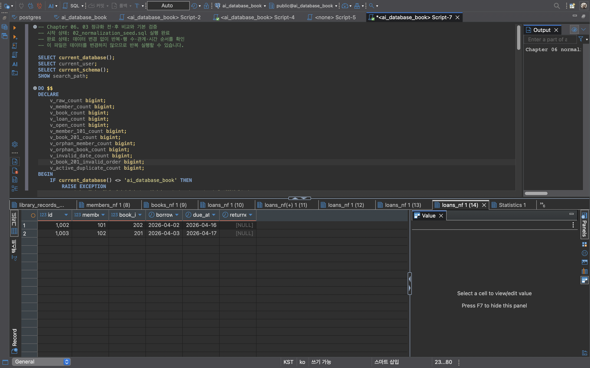

# Chapter 06 확장 실습 답안 템플릿

> **과제:** 정규화와 데이터 무결성으로 좋은 테이블 만들기  
> **사용 방법:** 이 파일을 내려받아 본인의 GitHub 저장소에 `chapter06_answer.md`라는 이름으로 저장한 뒤 실습하면서 바로 작성합니다.  
> **제출 방법:** LMS에는 파일을 직접 업로드하지 않고, **본인 GitHub 저장소의 `chapter06_answer.md` 파일 URL**을 제출합니다.

---

## 제출 전 주의

이 파일과 캡처 화면에는 실제 비밀번호, 전체 DB 접속 URL, API Key, 개인정보를 기록하지 않습니다.

```text
GitHub 계정 또는 별칭: han-jaesun
과제 작성일: 2026-10-19
사용한 AI 도구: Claude
```

---

# 1. 실습 환경과 시작 상태 확인

다음을 실행합니다.

```sql
SELECT current_database();
SELECT current_user;
SELECT current_schema();
SHOW search_path;
SHOW transaction_read_only;
```

| 확인 항목 | 실제 결과 | 의미 |
| --- | --- | --- |
| `current_database()` | ai_database_book | 실습용 데이터베이스에 연결되어 있다 |
| `current_user` | hanjaesun | 테이블을 만들고 규칙을 추가할 사용자로 접속했다 |
| `current_schema()` | public | 스키마 이름 없이 만든 테이블은 public에 생성된다 |
| `search_path` | public, "$user" | 테이블 이름만 쓰면 public에서 먼저 찾는다 |
| `transaction_read_only` | off | 읽기 전용이 아니라 테이블 생성·변경이 가능하다 |

- [x] 현재 DB가 `ai_database_book`이다.
- [x] 변경 가능한 연결인지 확인했다.
- [x] Auto-commit 상태를 확인했다.
- [x] Chapter 06 번호형 SQL 파일을 사용한다.

---

# 2. 정규화 전 큰 테이블의 문제 찾기

본문의 `library_records_raw` 구조를 기준으로 생각합니다.

```text
library_records_raw 한 행
→ 대여 사건 한 건이지만 회원·도서의 현재 사실까지 함께 저장된 구조
```

## 2-1. 위험한 중복과 의미 있는 반복 구분

| 반복되는 값/상황 | 위험한 중복 / 의미 있는 반복 | 판단 이유 |
| --- | --- | --- |
| 회원 이메일이 여러 대여 행에 반복 | 위험한 중복 | 회원 한 명의 현재 이메일이라는 같은 사실을 대여할 때마다 복사한 것이다. 이메일이 바뀌면 모든 행을 고쳐야 하고, 하나라도 빠지면 서로 다른 값이 남는다. |
| 도서 제목이 여러 대여 행에 반복 | 위험한 중복 | 도서의 제목은 도서에 대한 하나의 사실인데 대여 행마다 복사되었다. 제목을 고칠 때 일부 행만 바뀌면 같은 책이 서로 다른 제목을 갖게 된다. |
| `loans_nf.member_id = 101` 반복 | 의미 있는 반복 | 회원 정보를 복사한 것이 아니라 "회원 101이 여러 번 대여했다"는 관계를 표현한다. 각 행이 서로 다른 대여 사건이고, 회원 정보는 members_nf 한 곳에만 있다. |
| 사건 당시 가격 같은 이력값 반복 | 의미 있는 반복 (이력) | 대여·주문 당시의 값은 그 사건에 속한 사실이다. 나중에 현재 가격이 바뀌어도 당시 값은 그대로 보존되어야 하므로 사건 행에 남기는 것이 맞다. |

## 2-2. 이상 현상 설명

### 삽입 이상

```text
아직 한 번도 대여되지 않은 새 도서를 등록하려 할 때 생기는 문제:
library_records_raw는 한 행이 "대여 사건 한 건"이라서, 대여가 없으면 도서 정보를 넣을 자리가 없다.
새 도서를 등록하려면 가짜 대여 기록을 만들거나 회원·대여 칸을 비운 이상한 행을 넣어야 한다.
```

### 수정 이상

```text
회원 이메일이 변경될 때 생기는 문제:
김민지의 이메일은 1001, 1002 두 행에 복사되어 있어서 두 행을 모두 찾아 수정해야 한다.
한 행만 수정하면 같은 회원이 두 개의 이메일을 가진 것처럼 보이는 모순이 생기고, 어느 쪽이 맞는지 알 수 없다.
```

### 삭제 이상

```text
마지막 대여 기록을 삭제할 때 생길 수 있는 문제:
"SQL 기초"는 1002 한 행에만 있으므로, 이 대여 기록을 지우면 도서 제목과 저자 정보까지 함께 사라진다.
대여 사건 하나만 지우려 했는데 도서관이 그 책을 가지고 있다는 사실 자체가 없어진다.
```

### 왜 이것이 SQL 문법 문제가 아니라 구조 문제인가요?

```text
INSERT, UPDATE, DELETE는 모두 오류 없이 성공한다. 문제는 SQL이 아니라 한 테이블에 회원·도서·대여라는
서로 다른 주인의 사실을 섞어 둔 구조에 있다. 그래서 문법을 아무리 정확하게 써도 같은 사실이 여러 곳에
흩어져 있는 한 모순과 정보 손실이 생길 수 있다.
```

---

# 3. 1NF·2NF·3NF 핵심 질문 복습

정규형 이름만 외우지 말고 **왜 분리하는지** 설명합니다.

## 3-1. 제1정규형(1NF)

```text
한 셀에 쉼표로 여러 독립 값을 넣거나 book1/book2/book3처럼 반복 열을 만들면 왜 문제가 되는가:
"데이터베이스 입문, SQL 기초"처럼 한 칸에 여러 책을 넣으면, 각 책을 따로 검색하거나 한 권만 반납 처리하기 어렵고
책 번호로 다른 테이블과 FK로 연결할 수도 없다. book1/book2/book3처럼 칸을 늘리면 몇 권을 빌릴지 미리 정해야 하고,
대부분의 칸은 비게 되며, "SQL 기초를 빌린 사람"을 찾으려면 세 칸을 모두 뒤져야 한다.
각 값을 독립적으로 다뤄야 한다면 한 줄에 하나씩 저장해야 한다.
```

내 서비스에서 비슷한 위험이 있는 예:

```text
태스크허브에서 업무 담당자를 tasks 테이블의 assignees 칸에 "민지, 준호"처럼 넣거나,
선행 업무를 blocked_by 칸에 "3, 5"처럼 넣으면 1NF 위반이 된다.
그러면 "민지가 맡은 업무 전부"를 찾기 어렵고, 없는 팀원이나 없는 업무를 적어도 FK로 막을 수 없다.
그래서 담당자는 task_assignees 연결 테이블로 분리했고, 선행 업무가 여러 개일 수 있다는 점은
Chapter 05 시나리오 검증에서 발견해 task_dependencies 연결 테이블을 후보로 두었다.
```

## 3-2. 제2정규형(2NF)

```text
(student_id, course_id) → grade
student_id → student_name
course_id → course_name
```

```text
복합키 전체가 아니라 일부에만 의존하는 열을 분리해야 하는 이유:
grade는 어떤 학생이 어떤 과목에서 받은 성적이라 학생과 과목 둘 다 알아야 정해진다.
반면 student_name은 학생만 알면, course_name은 과목만 알면 정해지므로 수강 한 건의 사실이 아니다.
이 열들을 수강 테이블에 두면 학생 이름이 과목 수만큼, 과목 이름이 수강생 수만큼 복사되어 수정 이상이 생긴다.
그래서 students(id, name), courses(id, name), enrollments(student_id, course_id, grade)로 나눠
각 사실을 주인 테이블에 한 번만 저장한다.
```

## 3-3. 제3정규형(3NF)

```text
member_id → zip_code
zip_code → city
```

```text
일반 열이 다른 일반 열을 결정하는 구조를 검토해야 하는 이유:
city는 회원이 직접 정하는 값이 아니라 zip_code가 정해 주는 값이다. 즉 회원 → 우편번호 → 도시로 한 단계를 거쳐 정해진다.
이 구조를 회원 테이블에 그대로 두면 같은 우편번호를 가진 회원마다 도시가 복사되고, 우편번호와 도시가 맞지 않는
모순된 행도 들어갈 수 있다. 우편번호와 도시의 관계가 실제 업무 규칙이라면 별도 사실로 분리하는 것을 검토한다.
```

### 정규화는 값이 반복되기만 하면 무조건 분리하는 것인가요?

```text
아니다. loans_nf.member_id = 101이 여러 행에 반복되는 것은 회원 정보를 복사한 것이 아니라
"회원 101이 여러 번 대여했다"는 관계를 표현하는 의미 있는 반복이다. 대여 당시 가격처럼 사건 당시 값을 보존하는
이력도 반복되어 보이지만 그 사건에 속한 사실이다.
분리는 같은 사실의 복사본인지, 결정 관계가 실제 업무 규칙인지, 독립적으로 관리하고 변경 이유가 다른 사실인지를
확인한 뒤에 결정한다. 값이 반복된다는 이유만으로 테이블을 만들면 JOIN만 늘고 오히려 구조가 복잡해진다.
```

---

# 4. 각 열의 '사실의 주인' 찾기

| 열 | 어떤 사실을 설명하는가 | 주인 테이블 | 이유 |
| --- | --- | --- | --- |
| `member_name` | 회원의 이름 | `members_nf` | 회원 한 명에 대한 현재 사실이라 대여할 때마다 복사할 필요가 없다 |
| `member_email` | 회원의 연락 이메일 | `members_nf` | 회원의 현재 사실이며, 바뀌면 회원 한 곳만 수정해야 모순이 생기지 않는다 |
| `book_title` | 도서의 제목 | `books_nf` | 도서에 대한 사실이라 대여 횟수와 상관없이 한 번만 저장해야 한다 |
| `author` | 도서의 저자 | `books_nf` | 대여가 아니라 도서를 설명하는 값이다 |
| `borrowed_at` | 언제 빌렸는가 | `loans_nf` | 대여 사건마다 다른 값이므로 사건 한 건의 사실이다 |
| `due_at` | 언제까지 반납해야 하는가 | `loans_nf` | 같은 회원·같은 책이라도 대여할 때마다 다르게 정해진다 |
| `returned_at` | 실제로 언제 반납했는가 | `loans_nf` | 대여 사건 한 건의 결과이며, 미반납이면 비어 있다 |
| `member_id` | 이 대여를 한 회원이 누구인가 | `loans_nf` (FK) | 회원 정보를 복사한 것이 아니라 대여가 어느 회원에게 속하는지 가리키는 관계 표현이다 |
| `book_id` | 이 대여의 대상 도서가 무엇인가 | `loans_nf` (FK) | 도서 정보를 복사하지 않고 번호로 가리켜, 제목·저자는 books_nf에서 찾게 한다 |

정규화 후 한 행의 의미:

```text
members_nf 한 행 = 회원 한 명
books_nf 한 행 = 이 장에서 대여 대상으로 관리하는 도서 항목 한 건
loans_nf 한 행 = 특정 회원이 특정 도서를 대여한 사건 한 건
```

### 현재 사실과 사건 당시 이력을 구분하는 기준

```text
값이 바뀌었을 때 과거 기록도 함께 바뀌어야 하는지 묻는다.
회원 이메일처럼 바뀌면 모든 곳에서 새 값이 보여야 하는 것은 현재 사실이므로 주인 테이블에 한 번만 저장한다.
반대로 대여일·반납일이나 주문 당시 가격처럼, 나중에 다른 값이 바뀌어도 그때의 값이 그대로 남아야 하는 것은
사건 당시 이력이므로 사건 테이블에 저장한다.
```

---

# 5. PostgreSQL로 정규화 전·후 구조 재현

Public 저장소의 다음 파일을 순서대로 사용합니다.

```text
code/chapter06/01_normalization_schema.sql
code/chapter06/02_normalization_seed.sql
code/chapter06/03_normalization_compare.sql
```

## 5-1. `01_normalization_schema.sql`

실행 전 예상:

```text
생성될 테이블 수: 4개 (library_records_raw, members_nf, books_nf, loans_nf)
각 테이블 예상 행 수: 모두 0행
```

실행 후:

```text
실제로 생성된 테이블: library_records_raw, members_nf, books_nf, loans_nf
각 테이블 실제 행 수: 모두 0행
```

## 5-2. `02_normalization_seed.sql`

실행 전 예상 기준:

```text
raw = 3
members = 2
books = 2
loans = 3
미반납 = 2
회원 101 대여 = 2
도서 201 대여 = 2
```

실제 결과:

```text
raw: 3
members: 2
books: 2
loans: 3
미반납: 2
회원 101 대여: 2
도서 201 대여: 2
```

예상과 다른 값이 있다면 이유:

```text
예상과 모두 같았다. 정규화 전 raw 표는 대여 3건에 김민지의 이메일과 "데이터베이스 입문"의 제목·저자가 반복 저장되었고,
정규화 후에는 회원 2명·도서 2권이 각각 한 번씩만 저장되고 대여 3건은 member_id와 book_id로 회원과 도서를 가리킨다.
```

## 5-3. `03_normalization_compare.sql`

```text
검증 메시지: Chapter 06 normalization comparison passed
PASS / FAIL: PASS
```

다음 항목을 확인합니다.

```text
회원 고아 참조: 0
도서 고아 참조: 0
날짜 순서 오류: 0
활성 대여 중복: 0
```

### 정규화 후에도 JOIN으로 원래 업무 정보를 다시 볼 수 있는 이유

```text
정규화는 정보를 지우는 것이 아니라 각 사실을 주인 테이블로 옮기는 것이다.
loans_nf가 member_id와 book_id로 회원과 도서를 정확히 가리키고 있기 때문에,
JOIN으로 번호를 따라가면 "누가, 어떤 책을, 언제 빌렸는지"를 raw 표와 같은 모습으로 다시 만들 수 있다.
실제로 loans_nf, members_nf, books_nf를 JOIN한 결과가 library_records_raw의 3행과 같은 내용으로 나왔다.
다만 이번에는 이메일과 제목이 한 곳에만 저장되어 있어 수정 이상이 생기지 않는다.
```

### 증거 화면

권장 경로:

```text
assignments/chapter06/images/step05_normalization.png
```



---

# 6. Chapter 06에서 확정한 C-01~C-08 정책 해석

| ID | 확정 규칙 | 구현 방법 | 왜 필요한가 | Chapter 05에서는 왜 미확정이었나 |
| --- | --- | --- | --- | --- |
| C-01 | 이메일 문자열 중복 금지 | `UNIQUE` | 같은 이메일로 회원이 두 번 등록되면 어느 회원인지 구분할 수 없고 연락·로그인이 꼬인다 | 가족이 이메일을 함께 쓰는 경우 등 고유성이 요구사항에 없어 Q1으로 남겼다 |
| C-02 | ISBN 필수·중복 금지 | `NOT NULL + UNIQUE` | ISBN이 없거나 같은 ISBN이 여러 행이면 도서를 정확히 찾을 수 없다 | R-03이 ISBN을 "저장할 수 있다"고만 했고, 복본 정책도 정해지지 않아 Q2·Q3로 남겼다 |
| C-03 | 이름·제목 공백 금지 | `CHECK` | NOT NULL은 빈칸('')이나 공백('  ')을 막지 못해, 이름 없는 회원이나 제목 없는 도서가 저장될 수 있다 | Chapter 05는 값의 존재(NOT NULL)까지만 다뤘고, 값의 내용 규칙은 정하지 않았다 |
| C-04 | `due_at >= borrowed_at` | `CHECK` | 반납예정일이 대여일보다 빠른 대여는 시간상 불가능한 잘못된 데이터다 | Chapter 05 11번에서 "날짜 순서 오류를 막지 못한다"는 한계로만 기록하고 규칙은 Chapter 06으로 미뤘다 |
| C-05 | `returned_at`은 NULL 또는 대여일 이상 | `CHECK` | 빌리기 전에 반납하는 것은 불가능하다. 단, 미반납 상태를 표현하기 위해 NULL은 허용해야 한다 | 미반납을 NULL로 표현하는 것만 확정했고(R-07), 날짜 선후 규칙은 정하지 않았다 |
| C-06 | 존재하는 회원·도서만 참조 | `FOREIGN KEY` | 없는 회원이나 없는 도서를 가리키는 고아 대여 기록을 막는다 | Chapter 05에서도 FK는 적용했다. Chapter 06의 loans_nf는 비교 실습을 위해 규칙 없이 만든 뒤 다시 추가한다 |
| C-07 | 대여 이력이 있는 부모 삭제 금지 | `ON DELETE RESTRICT` | 대여 기록이 있는 회원·도서를 지우면 이력이 고아가 되거나 함께 사라진다. 기록 보존을 위해 삭제를 막는다 | 탈퇴 회원의 대여 기록을 삭제할지 보관할지(Q7)가 정해지지 않았다 |
| C-08 | 도서당 미반납 대여 최대 한 건 | 부분 고유 인덱스 | 실물 한 권을 두 사람이 동시에 빌린 것으로 기록되는 것을 막는다 | 같은 책의 동시 대여 가능 여부(Q5)와 복본 정책(Q3)이 정해지지 않았다 |

### 확정되지 않은 정책을 제약조건으로 먼저 만들면 위험한 이유

```text
제약조건은 DBMS가 예외 없이 강제하는 규칙이라, 실제 업무와 다르면 정상 데이터까지 막는다.
예를 들어 복본 정책이 정해지기 전에 ISBN에 UNIQUE를 걸면 같은 책 두 번째 권을 등록할 수 없다.
또 C-07 대신 ON DELETE CASCADE처럼 삭제 규칙을 잘못 정하면, 회원 하나를 지울 때 대여 이력까지 함께 사라져 되돌릴 수 없다.
그래서 Chapter 05에서는 질문으로 남겨 두었고, Chapter 06에서 정책이 확정된 뒤에야 제약조건으로 옮긴다.
```

---

# 7. 기존 데이터 검사 후 무결성 규칙 적용

실행 파일:

```text
code/chapter06/04_add_integrity_rules.sql
```

## 7-1. 규칙을 추가하기 전에 기존 데이터를 먼저 검사해야 하는 이유

```text
이미 저장된 데이터가 새 규칙을 어기고 있으면 ALTER TABLE 자체가 실패한다. 예를 들어 같은 이메일을 가진 회원이
두 명 있으면 UNIQUE를 추가할 수 없다. 이때 어느 행이 잘못된 것인지, 병합할지 수정할지는 DBMS가 대신 정해 주지 않으므로
먼저 위반 데이터를 찾아 업무적으로 처리 방침을 정한 뒤 규칙을 적용해야 한다.
04 파일도 규칙을 추가하기 전에 NULL 값, 이메일·ISBN 중복, 빈 이름·제목, 날짜 순서 오류, 고아 참조, 활성 대여 중복을
먼저 검사하고, 위반이 없을 때만 규칙을 적용한다.
```

## 7-2. 실행 결과

```text
명명된 제약조건 개수: 8개
  (uq_members_nf_email, chk_members_nf_name_not_blank, uq_books_nf_isbn, chk_books_nf_title_not_blank,
   fk_loans_nf_member, fk_loans_nf_book, chk_loans_nf_due_date, chk_loans_nf_returned_date)
NOT NULL 적용 열 개수: 10개
  (members_nf: name, email, joined_at / books_nf: title, author, isbn / loans_nf: member_id, book_id, borrowed_at, due_at)
부분 고유 인덱스 존재 여부: 존재 (uq_loans_nf_active_book)
COMMIT 성공 여부: 성공 (오류 없이 전체 트랜잭션이 끝났고, 이후 조회에서 규칙과 인덱스가 확인되었다)
```

### 메타데이터를 확인하는 이유

```text
ALTER TABLE이 오류 없이 끝났다고 해서 의도한 규칙이 모두 정확한 테이블과 열에 들어갔다고 보장할 수 없다.
pg_constraint와 pg_attribute 같은 시스템 정보를 직접 조회하면, 규칙의 이름·종류·대상 테이블과 NOT NULL 적용 열을
눈으로 확인할 수 있어 빠지거나 잘못 걸린 규칙을 찾을 수 있다. 또 규칙 이름을 미리 알아 두면, 이후 실패 테스트에서
오류 메시지에 나온 이름으로 어떤 규칙이 데이터를 막았는지 바로 알 수 있다.
```

### 증거 화면

권장 경로:

```text
assignments/chapter06/images/step07_constraints.png
```


---

# 8. 정상·경계·실패 테스트

실행 파일:

```text
code/chapter06/05_integrity_tests.sql
```

> **중요:** 오류 테스트는 한 번에 하나씩 실행하고, 각 테스트가 끝난 뒤 기준 데이터가 유지되는지 확인합니다.

## 8-1. 허용되어야 하는 경계값

| 테스트 | 예상 | 실제 | 왜 허용되어야 하는가 |
| --- | --- | --- | --- |
| `due_at = borrowed_at` | 성공 | 성공 | C-04는 "반납예정일 ≥ 대여일"이므로 같은 날은 규칙의 경계 안이다. 당일 반납 대여는 실제 업무에서도 가능하다. |
| `returned_at = borrowed_at` | 성공 | 성공 | C-05는 "반납일 ≥ 대여일"이므로 빌린 날 바로 반납하는 경우를 막으면 안 된다. |
| `returned_at = NULL` | 성공 | 성공 | 미반납 대여를 표현하기 위해 NULL을 허용하기로 했다(R-07, C-05). |
| `published_year = NULL` | 성공 | 성공 | 출판연도는 선택값이며 C-01~C-08 어디에도 필수로 정하지 않았다. 연도 미상 도서도 등록할 수 있어야 한다. |
| 공백이 아닌 한 글자 이름 | 성공 | 성공 | C-03은 "공백만 있는 이름"을 막는 규칙이지 짧은 이름을 막는 규칙이 아니다. '김'처럼 한 글자 이름도 정상이다. |

## 8-2. 실패해야 하는 오류값

| 오류 테스트 | 기대 규칙 | 실제 결과 | 오류 메시지 핵심 | 실패해야 하는 이유 |
| --- | --- | --- | --- | --- |
| 필수값 NULL | `NOT NULL` | 실패 | null value in column "name" ... violates not-null constraint | 이름 없는 회원은 누구인지 알 수 없다 |
| ISBN NULL | `NOT NULL` | 실패 | null value in column "isbn" ... violates not-null constraint | C-02에서 ISBN을 필수로 확정했다 |
| 이메일 중복 | `UNIQUE` | 실패 | duplicate key value violates unique constraint "uq_members_nf_email" | junho@example.com은 이미 이준호의 이메일이다(C-01) |
| ISBN 중복 | `UNIQUE` | 실패 | duplicate key value violates unique constraint "uq_books_nf_isbn" | ISBN-001은 이미 "데이터베이스 입문"의 ISBN이다(C-02) |
| 공백 이름/제목 | `CHECK` | 실패 | violates check constraint "chk_members_nf_name_not_blank" | '   '는 NULL은 아니지만 실제 이름이 아니다(C-03) |
| 존재하지 않는 회원 | `FOREIGN KEY` | 실패 | violates foreign key constraint "fk_loans_nf_member" | 999번 회원은 없으므로 고아 대여 기록이 된다(C-06) |
| 존재하지 않는 도서 | `FOREIGN KEY` | 실패 | violates foreign key constraint "fk_loans_nf_book" | 999번 도서는 없으므로 고아 대여 기록이 된다(C-06) |
| 날짜 순서 위반 | `CHECK` | 실패 | violates check constraint "chk_loans_nf_due_date" | 4/20에 빌려 4/10까지 반납하는 것은 시간상 불가능하다(C-04) |
| 두 번째 미반납 대여 | 부분 고유 인덱스 | 실패 | duplicate key value violates unique constraint "uq_loans_nf_active_book" | 도서 201은 이미 대여 1003으로 미반납 상태라 동시에 또 빌릴 수 없다(C-08) |
| 참조 중 부모 삭제 | `RESTRICT/FK` | 실패 | update or delete on table "members_nf" violates foreign key constraint "fk_loans_nf_member" | 회원 101은 대여 기록 2건이 있어 지우면 이력이 고아가 된다(C-07) |

## 8-3. 테스트 후 기준 상태 재검증

```text
raw: 3
members: 2
books: 2
loans: 3
미반납: 2
회원 고아 참조: 0
도서 고아 참조: 0
활성 대여 중복: 0
검증 메시지: Chapter 06 integrity test baseline preserved
```

### 실패 테스트 후 기준 데이터가 유지되어야 하는 이유

```text
제약조건은 잘못된 데이터를 거부할 뿐 아니라, 거부된 문장이 기존 데이터를 하나도 바꾸지 않아야 의미가 있다.
실패한 INSERT가 일부만 들어가거나 실패한 DELETE가 다른 행을 지웠다면 데이터가 이미 망가진 것이다.
또 경계값 테스트로 넣은 임시 행을 지우지 않으면 다음 테스트의 기준이 달라진다. 그래서 테스트가 끝난 뒤
회원 2명·도서 2권·대여 3건·미반납 2건이라는 기준 상태가 그대로인지 다시 확인한다.
```

### 증거 화면

권장 경로:

```text
assignments/chapter06/images/step08_integrity_error.png
```


---

# 9. 정규화와 무결성 제약조건 역할 비교

| 질문 | 나의 설명 |
| --- | --- |
| 정규화가 해결하는 문제 |  |
| `NOT NULL`이 해결하는 문제 |  |
| `UNIQUE`가 해결하는 문제 |  |
| `CHECK`가 해결하는 문제 |  |
| `FOREIGN KEY`가 해결하는 문제 |  |
| 부분 고유 인덱스가 해결하는 문제 |  |

### 정규화만 잘하면 잘못된 데이터가 모두 차단되나요?

```text

```

### 제약조건만 많이 넣으면 나쁜 구조가 좋은 구조가 되나요?

```text

```

---

# 10. Chapter 05 개인 ERD 개선

Chapter 05에서 만든 개인 서비스 ERD를 다시 엽니다.

## 10-1. 수정 전 점검

- [ ] 같은 현재 사실을 여러 테이블에 복사한 부분이 있는가?
- [ ] 한 셀에 여러 독립 값을 넣으려 한 부분이 있는가?
- [ ] 사건과 현재 상태가 한 테이블에 섞였는가?
- [ ] 복합키 일부에만 의존하는 속성이 있는가?
- [ ] 일반 열이 다른 일반 열을 결정하는 부분이 있는가?
- [ ] 확정 업무 규칙인데 DB가 막지 못하는 부분이 있는가?
- [ ] 아직 미확정인데 제약조건으로 너무 강하게 정한 부분이 있는가?

## 10-2. 수정 전·후 비교

| 항목 | 수정 전 | 수정 후 | 변경 근거 | 관련 요구사항 ID |
| --- | --- | --- | --- | --- |
|  |  |  |  |  |
|  |  |  |  |  |
|  |  |  |  |  |

## 10-3. 개인 프로젝트 무결성 규칙 후보

| 규칙 ID | 업무 규칙 | 제약조건 후보 | 확정 / 미확정 | 근거 |
| --- | --- | --- | --- | --- |
| P06-C01 |  |  |  |  |
| P06-C02 |  |  |  |  |
| P06-C03 |  |  |  |  |
| P06-C04 |  |  |  |  |
| P06-C05 |  |  |  |  |

> 미확정 규칙은 `확인 필요`로 남겨도 됩니다. 억지로 제약조건을 만들지 않습니다.

## 10-4. 수정한 ERD

권장 이미지 경로:

```text
assignments/chapter06/images/step10_my_erd_after.png
```

`여기에 수정한 개인 ERD 이미지를 삽입하세요.`

---

# 11. AI를 정규화·무결성 리뷰어로 활용

## 11-1. 내가 먼저 작성한 구조와 규칙

```text
내 서비스:
검토할 테이블:
한 행의 의미:
중복으로 의심되는 열:
확정 업무 규칙:
미확정 정책:
```

## 11-2. AI에게 전달한 핵심 프롬프트

```text

```

## 11-3. AI 제안 검토

| AI 제안 | 수용 / 수정 / 보류 / 거절 | 요구사항 근거 | 실제 검증 방법 | 나의 판단 |
| --- | --- | --- | --- | --- |
|  |  |  |  |  |
|  |  |  |  |  |
|  |  |  |  |  |
|  |  |  |  |  |

특히 AI가 다음을 제안했다면 근거를 다시 확인합니다.

```text
UNIQUE
NOT NULL
CHECK
ON DELETE CASCADE
ON DELETE RESTRICT
새로운 테이블 분리
```

### AI가 단순히 값이 반복된다는 이유만으로 분리를 제안한 부분이 있었나요?

```text

```

### AI가 미확정 정책을 확정 규칙처럼 만든 부분이 있었나요?

```text

```

---

# 12. 최종 성찰

아래 문장은 본인의 말로 작성합니다.

```text
1. 정규화에서 가장 중요한 질문은
   ____________________________________________________________ 이다.

2. 위험한 중복과 의미 있는 반복의 차이는
   ____________________________________________________________ 이다.

3. 정규화와 제약조건의 역할이 다른 이유는
   ____________________________________________________________ 이다.

4. 실패해야 하는 SQL을 일부러 실행해 보는 이유는
   ____________________________________________________________ 이다.

5. AI가 제안한 UNIQUE/CHECK/FK를 그대로 적용하면 안 되는 이유는
   ____________________________________________________________ 이다.
```

---

# 13. 제출 체크리스트

- [ ] `chapter06_answer.md`를 본인 저장소에 만들었다.
- [ ] 위험한 중복과 의미 있는 반복을 구분했다.
- [ ] 삽입·수정·삭제 이상을 설명했다.
- [ ] 1NF·2NF·3NF 핵심 질문을 자신의 말로 설명했다.
- [ ] 열의 사실의 주인을 분류했다.
- [ ] `01_normalization_schema.sql`을 실행했다.
- [ ] `02_normalization_seed.sql` 기준 상태를 확인했다.
- [ ] `03_normalization_compare.sql` 검증 결과를 확인했다.
- [ ] C-01~C-08의 업무 근거를 설명했다.
- [ ] `04_add_integrity_rules.sql`로 규칙을 적용했다.
- [ ] 허용 경계값을 최소 3개 확인했다.
- [ ] 실패 테스트를 최소 6개 한 번에 하나씩 실행했다.
- [ ] 실패 후 기준 데이터가 유지되는지 확인했다.
- [ ] Chapter 05 개인 ERD를 수정했다.
- [ ] 개인 프로젝트 제약조건 후보를 확정/미확정으로 구분했다.
- [ ] AI 제안을 요구사항 근거와 실행 결과로 검토했다.
- [ ] 핵심 화면 3~4장만 첨부했다.
- [ ] 캡처에 비밀번호나 개인정보가 없다.
- [ ] GitHub에서 Markdown 이미지가 정상적으로 보인다.
- [ ] 최종 답안을 commit/push했다.

---

# 14. LMS 제출 URL

아래 형식의 **본인 GitHub 파일 URL**을 LMS에 제출합니다.

```text
https://github.com/<본인-GitHub-ID>/<본인-저장소>/blob/main/assignments/chapter06/chapter06_answer.md
```

내 제출 URL:

```text

```

> 저장소 메인 URL, 교수자 템플릿 URL, Raw URL이 아니라 **작성 완료된 본인 `chapter06_answer.md` 파일 화면 URL**을 제출합니다.
